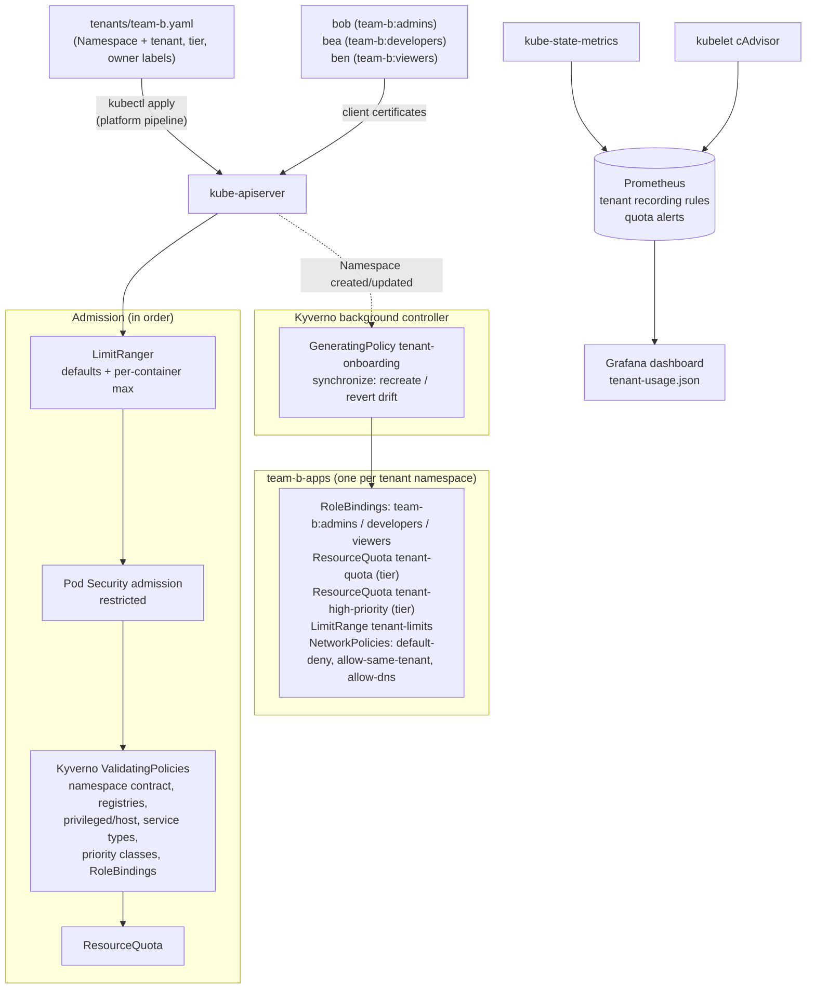

# k8s-multi-tenancy

[](https://github.com/ahmedelgmal310/k8s-multi-tenancy/actions/workflows/ci.yml)
[](LICENSE)

One shared Kubernetes cluster, several teams, and no way for one team to read,
break or starve another. Each team is onboarded by **one small YAML file**.
**Kyverno** turns it into isolated namespaces with:

- team **admin / developer / viewer** RBAC bound to the team's groups
- a **ResourceQuota** and **LimitRange** sized by the team's tier
- **default-deny NetworkPolicies** that only allow traffic inside the tenant
- the **restricted Pod Security Standard**
- per-tier access to a high **priority class**

Admission guardrails do the rest: approved registries only, no privileged or
host access, no LoadBalancer/NodePort services, no cross-tenant RoleBindings,
and tenants cannot touch cluster-scoped resources at all.

Every push to `main` builds the whole platform on a throwaway **kind** cluster,
creates real per-team users (client certificates signed by the cluster CA), and
runs a **tenancy conformance matrix**: 63 ordinary `kubectl` and `curl` calls,
each made as a specific team member, each with an expected result (allowed,
or denied by a named layer). One mismatch fails the job. The same job also
runs the following checks:

- a **noisy-neighbour test**: team-b tries to take the whole node, and team-a's
  latency is measured before and during
- **per-tenant metrics and alerts** in Prometheus, including every query of the
  Grafana dashboard
- the **runbook** itself: onboard, repair drift, raise a quota, offboard

## Contents

- [The problem](#the-problem)
- [Architecture](#architecture)
- [How onboarding works](#how-onboarding-works)
- [Why Kyverno, not Capsule or HNC](#why-kyverno-not-capsule-or-hnc)
- [Tenant roles](#tenant-roles)
- [Guardrails](#guardrails)
- [Tenancy conformance matrix](#tenancy-conformance-matrix)
- [Fair share: the noisy neighbour](#fair-share-the-noisy-neighbour)
- [Per-tenant usage, alerts and dashboard](#per-tenant-usage-alerts-and-dashboard)
- [Results from CI](#results-from-ci)
- [Supply chain and quality gates](#supply-chain-and-quality-gates)
- [Limitations](#limitations)
- [Runbook](#runbook)
- [Repository layout](#repository-layout)
- [Local development](#local-development)

## The problem

Giving every team its own cluster is expensive and slow, so most companies end
up sharing clusters. A plain namespace is not a security boundary, though:

- **RBAC**: a namespace on its own grants nothing and protects nothing.
  Someone has to bind the right roles to the right groups, every time, and make
  sure nobody can grant themselves more.
- **Network**: pods can reach every other pod in the cluster by default,
  including other teams' databases.
- **Resources**: without quotas and limits, one team's runaway Deployment can
  use the whole node, and the other teams' services slow down or get evicted.
- **Workloads**: without admission control, a tenant can run a privileged pod,
  mount the node's filesystem, pull any image from anywhere, or expose a
  LoadBalancer to the internet.
- **Drift**: hand-made per-team setups diverge. One namespace is missing its
  NetworkPolicy, and nobody notices until an incident.

What a platform team needs is a **repeatable onboarding contract** (same
guardrails for every team, created automatically) and **proof** that the
isolation works: tests that act as each team member and check what is
allowed and what is denied.

## Architecture



The order of the admission chain matters for the matrix, because each denied
row names the layer that must reject it. RBAC runs before any of this (an
unauthorised request never reaches admission), and the built-in LimitRanger and
Pod Security plugins run before the Kyverno webhook. ResourceQuota runs last.

## How onboarding works

A tenant is described by its namespaces. This is the complete onboarding file
for team-b ([`tenants/team-b.yaml`](tenants/team-b.yaml)):

```yaml
apiVersion: v1
kind: Namespace
metadata:
  name: team-b-apps
  labels:
    tenancy.io/tenant: team-b
    tenancy.io/tier: small
    tenancy.io/owner: team-b-leads
    pod-security.kubernetes.io/enforce: restricted
    pod-security.kubernetes.io/enforce-version: latest
```

1. **The contract is checked at admission.** The
   [`tenant-namespace-contract`](platform/policies/tenant-namespace-contract.yaml)
   ValidatingPolicy rejects the namespace unless it has a valid tenant name, a
   known tier and an owner, is named `<tenant>-*` (team-a cannot create
   `team-b-impostor`), and enforces Pod Security `restricted`.
2. **Kyverno creates the tenant objects.** The
   [`tenant-onboarding`](platform/policies/tenant-onboarding.yaml)
   GeneratingPolicy matches any namespace with a `tenancy.io/tenant` label and
   creates 9 objects in it from a CEL-interpolated YAML template:

   | Object | Purpose |
   |---|---|
   | RoleBinding `tenant-admins` / `tenant-developers` / `tenant-viewers` | binds the tenant ClusterRoles to the groups `<tenant>:admins`, `<tenant>:developers`, `<tenant>:viewers` |
   | ResourceQuota `tenant-quota` | CPU/memory requests and limits, pods, services, PVCs by tier; `services.loadbalancers` and `services.nodeports` are 0 |
   | ResourceQuota `tenant-high-priority` | how many pods may use the `tenant-high` priority class (0 on the small tier) |
   | LimitRange `tenant-limits` | default requests 100m/128Mi and limits 200m/256Mi for containers that set none; per-container max by tier |
   | NetworkPolicy `default-deny-all` | no ingress, no egress |
   | NetworkPolicy `allow-same-tenant` | ingress from and egress to namespaces with the same `tenancy.io/tenant` label |
   | NetworkPolicy `allow-dns-egress` | egress to kube-dns on port 53 only |

3. **`synchronize` keeps them that way.** A tenant cannot edit these objects
   (RBAC), and if anyone else deletes or edits one, Kyverno recreates or
   reverts it. CI deletes a tenant's `default-deny-all` as cluster-admin and
   measures how long it takes to come back (about 0.1 s).
4. **Tiers, not hand-tuned numbers.** Sizes live in one map in the policy:

   | Tier | requests CPU / memory | limits CPU / memory | pods | services | PVCs | `tenant-high` pods | max per container |
   |---|---|---|---|---|---|---|---|
   | small | 1 / 1Gi | 2 / 2Gi | 10 | 5 | 2 | 0 | 1 CPU / 1Gi |
   | medium | 2 / 4Gi | 4 / 8Gi | 30 | 10 | 5 | 5 | 2 CPU / 2Gi |
   | large | 4 / 8Gi | 8 / 16Gi | 60 | 20 | 10 | 10 | 4 CPU / 4Gi |

   Raising a team's quota is a one-line change to its tier label, reviewed in a
   pull request.

The team members themselves are identified by group: whatever authenticates
users (here client certificates; in production an OIDC provider) only has to
put `team-b:developers` in the user's groups.

## Why Kyverno, not Capsule or HNC

| Option | Pros | Why not here |
|---|---|---|
| **Kyverno GeneratingPolicy + ValidatingPolicies** (chosen) | One engine for onboarding *and* guardrails; everything is plain Kubernetes objects (Namespaces, RoleBindings, quotas) that any tool understands; policies are unit-tested offline with the Kyverno CLI; `synchronize` repairs drift | No tenant-wide aggregate quota, and tenants cannot create namespaces themselves (see [Limitations](#limitations)) |
| Capsule `Tenant` CRD | Tenant-wide quotas across namespaces; tenant owners create their own namespaces | A second controller with its own CRDs in the admission path, on top of the policy engine the guardrails need anyway; two engines to upgrade, test and keep available |
| Hierarchical Namespace Controller | Sub-namespaces and policy propagation from parent namespaces | Solves namespace hierarchy, not quotas, admission guardrails or network isolation; those would still need another engine |

The deciding factor was reliability and testability. Every Kyverno policy here
has offline unit tests (55 cases, `platform/policies/tests`). The live
behaviour is checked by the conformance matrix on every push. The tenant
objects are ordinary Kubernetes resources, and the policy sets
`orphanDownstreamOnPolicyDelete`, so deleting the policy or uninstalling
Kyverno leaves existing tenants' RBAC, quotas and NetworkPolicies in place
(configured, not exercised in CI).

## Tenant roles

Defined once as ClusterRoles in [`platform/rbac/tenant-roles.yaml`](platform/rbac/tenant-roles.yaml)
and only ever granted through RoleBindings in tenant namespaces.

| | viewer | developer | admin |
|---|---|---|---|
| read workloads, services, ConfigMaps, events, logs, quota usage | yes | yes | yes |
| create/update/delete Deployments, StatefulSets, Jobs, Services, ConfigMaps, PVCs, HPAs, PDBs | | yes | yes |
| Secrets (read or write) | | | yes |
| ServiceAccounts, `exec`, `port-forward` | | | yes |
| RoleBindings to tenant roles for **own** groups | | | yes |
| ResourceQuota, LimitRange, NetworkPolicy, Namespace changes | no | no | no |
| any cluster-scoped resource | no | no | no |

A tenant admin can grant `tenant-viewer` to `team-a:viewers`. The admin cannot
grant anything to `team-b:*` or to individual users (Kyverno
`restrict-tenant-rolebindings`), and cannot bind `cluster-admin`, `admin` or
`edit`: Kyverno blocks those roles, and so does Kubernetes' own RBAC escalation
check, because the admin does not hold those permissions.

## Guardrails

| Guardrail | Enforced by | Covered in |
|---|---|---|
| Restricted Pod Security Standard on every tenant namespace | namespace label (required by `tenant-namespace-contract`) + Pod Security admission | matrix `adm-privileged-pod`, `adm-hostpath-pod` |
| No privileged containers, privilege escalation, hostPath, host network/PID/IPC, hostPort, **also on Deployments/Jobs** (Pod Security admission only warns there) | Kyverno `disallow-privileged-and-host-access` (autogen for pod controllers) | `adm-privileged-deploy`, `adm-hostpath-deploy`, CLI tests |
| Images only from `registry.k8s.io/`, `ghcr.io/ahmedelgmal310/`, `docker.io/curlimages/curl`, registry written out in full | Kyverno `restrict-image-registries` | `adm-unapproved-registry`, CLI tests (implicit `docker.io`, look-alike host) |
| `app.kubernetes.io/name` label on every workload | Kyverno `require-workload-labels` | `adm-missing-labels` |
| ClusterIP services only (no LoadBalancer, NodePort, ExternalName, externalIPs) | Kyverno `restrict-service-types` + quota `services.loadbalancers/nodeports: 0` | `adm-loadbalancer`, `adm-nodeport`, CLI tests |
| Only `tenant-standard` / `tenant-high` priority classes, `tenant-high` by tier | Kyverno `restrict-priority-classes` + `tenant-high-priority` quota | `adm-system-priority`, `prio-high-*` |
| RoleBindings only to tenant roles and own groups | Kyverno `restrict-tenant-rolebindings` + RBAC escalation check | `guard-*` |
| No cluster-scoped resources, no Namespace, quota, LimitRange or NetworkPolicy changes | RBAC (tenant roles have no such verbs) | `cluster-*`, `guard-*` |

The Kyverno webhooks fail closed. If Kyverno is unavailable, writes covered by
the guardrails are rejected instead of admitted unchecked.

## Tenancy conformance matrix

[`conformance/matrix.tsv`](conformance/matrix.tsv) has one row per check:
identity, method, target, expected result. [`e2e/conformance.sh`](e2e/conformance.sh)
runs each row as that identity and records the observed result.

- **Identities** are created per run by [`e2e/identities.sh`](e2e/identities.sh).
  For each of alice/amir/ava (team-a admin/developer/viewer) and bob/bea/ben
  (team-b), it creates an EC key on the runner and sends a
  `CertificateSigningRequest` with subject `CN=<user>, O=<tenant>:<role>s` to
  the `kubernetes.io/kube-apiserver-client` signer. The certificate lives for 1
  hour. The script checks `kubectl auth whoami` to confirm the API server sees
  that user and group. Nothing is committed; the files are deleted at the end
  of the job.
- **Methods**: `kubectl` (normal CLI as the identity), `api` (`curl` with the
  identity's client certificate straight to the API server, so the result
  does not depend on kubectl behaviour), `http` (`curl` inside a tenant pod,
  through `kubectl exec` as the identity, for network rows).
- **Expected** is `allowed` or `denied:<layer>`. The observed layer comes from
  the API error: `rbac` (`Forbidden ... cannot`), `policy` (Kyverno webhook
  denied), `pss` (`violates PodSecurity`), `quota` (`exceeded quota`),
  `limitrange` (`maximum cpu usage per Container`), `netpol` (connection timed
  out). A denial by the *wrong* layer is a failure too. For example, if a
  privileged Deployment were stopped only because its pods later fail, that
  would not count. A DNS failure is not a network-policy denial either.
- Some allowed rows also read back what the cluster did. For example, the pod
  created without resources must come back with requests `100m/128Mi` and
  limits `200m/256Mi`, and the `tenant-high` pod with priority `10000`.

Result of the linked run: **63/63 as expected** (19 allowed; denied: 26 rbac,
9 policy, 2 pss, 2 quota, 1 limitrange, 4 netpol).

**Own tenant: what each role may do** (14)

| Identity | Action | Via | Expected | Observed |
|---|---|---|---|---|
| alice (team-a admin) | team-a admin lists pods in its own namespace | kubectl | allowed | allowed |
| alice (team-a admin) | team-a admin creates a Secret in its own namespace | kubectl | allowed | allowed |
| alice (team-a admin) | team-a admin reads Secrets in its own namespace (curl, raw API) | api | allowed | allowed |
| alice (team-a admin) | team-a admin grants tenant-viewer to its own viewers group | kubectl | allowed | allowed |
| alice (team-a admin) | team-a admin execs into its own pod | kubectl | allowed | allowed |
| alice (team-a admin) | team-a admin works in its second namespace (one identity, all tenant namespaces) | kubectl | allowed | allowed |
| amir (team-a developer) | team-a developer creates a compliant Deployment | kubectl | allowed | allowed |
| amir (team-a developer) | team-a developer creates a ConfigMap | kubectl | allowed | allowed |
| amir (team-a developer) | team-a developer reads pod logs | kubectl | allowed | allowed |
| amir (team-a developer) | team-a developer scales a Deployment | kubectl | allowed | allowed |
| amir (team-a developer) | team-a developer can see its quota and usage | kubectl | allowed | allowed |
| ava (team-a viewer) | team-a viewer lists Deployments | kubectl | allowed | allowed |
| ava (team-a viewer) | team-a viewer lists pods (curl, raw API) | api | allowed | allowed |
| bob (team-b admin) | team-b admin lists pods in its own namespace | kubectl | allowed | allowed |

**Role boundaries inside a tenant** (6)

| Identity | Action | Via | Expected | Observed |
|---|---|---|---|---|
| ava (team-a viewer) | team-a viewer tries to create a ConfigMap | kubectl | denied:rbac | denied:rbac |
| ava (team-a viewer) | team-a viewer tries to read Secrets | kubectl | denied:rbac | denied:rbac |
| ava (team-a viewer) | team-a viewer tries to delete pods | kubectl | denied:rbac | denied:rbac |
| amir (team-a developer) | team-a developer tries to read Secrets | kubectl | denied:rbac | denied:rbac |
| amir (team-a developer) | team-a developer tries to exec into a pod | kubectl | denied:rbac | denied:rbac |
| amir (team-a developer) | team-a developer tries to make its own group admin | kubectl | denied:rbac | denied:rbac |

**Guardrail objects and privilege escalation** (8)

| Identity | Action | Via | Expected | Observed |
|---|---|---|---|---|
| alice (team-a admin) | team-a admin tries to delete its ResourceQuota | kubectl | denied:rbac | denied:rbac |
| alice (team-a admin) | team-a admin tries to modify its LimitRange | kubectl | denied:rbac | denied:rbac |
| alice (team-a admin) | team-a admin tries to delete the default-deny NetworkPolicy | kubectl | denied:rbac | denied:rbac |
| alice (team-a admin) | team-a admin tries to add an allow-all NetworkPolicy | kubectl | denied:rbac | denied:rbac |
| alice (team-a admin) | team-a admin tries to switch its namespace to the privileged Pod Security level | kubectl | denied:rbac | denied:rbac |
| alice (team-a admin) | team-a admin tries to bind cluster-admin in its namespace (RBAC escalation check) | kubectl | denied:rbac | denied:rbac |
| alice (team-a admin) | team-a admin tries to give team-b access to its namespace | kubectl | denied:policy | denied:policy |
| alice (team-a admin) | team-a admin tries to grant access to an individual user outside the group model | kubectl | denied:policy | denied:policy |

**Cross-tenant API access** (8)

| Identity | Action | Via | Expected | Observed |
|---|---|---|---|---|
| alice (team-a admin) | team-a admin lists team-b's pods | kubectl | denied:rbac | denied:rbac |
| alice (team-a admin) | team-a admin reads team-b's Secrets (curl, raw API) | api | denied:rbac | denied:rbac |
| alice (team-a admin) | team-a admin creates a ConfigMap in team-b's namespace | kubectl | denied:rbac | denied:rbac |
| amir (team-a developer) | team-a developer deletes team-b's Deployment | kubectl | denied:rbac | denied:rbac |
| amir (team-a developer) | team-a developer scales team-b's Deployment to zero | kubectl | denied:rbac | denied:rbac |
| bob (team-b admin) | team-b admin reads team-a's ConfigMaps | kubectl | denied:rbac | denied:rbac |
| bob (team-b admin) | team-b admin execs into team-a's pod | kubectl | denied:rbac | denied:rbac |
| ben (team-b viewer) | team-b viewer reads team-a's logs | kubectl | denied:rbac | denied:rbac |

**Cluster-scoped resources** (6)

| Identity | Action | Via | Expected | Observed |
|---|---|---|---|---|
| alice (team-a admin) | team-a admin creates a ClusterRole | kubectl | denied:rbac | denied:rbac |
| alice (team-a admin) | team-a admin creates a namespace itself | kubectl | denied:rbac | denied:rbac |
| alice (team-a admin) | team-a admin creates a PriorityClass | kubectl | denied:rbac | denied:rbac |
| alice (team-a admin) | team-a admin lists all namespaces (curl, raw API) | api | denied:rbac | denied:rbac |
| alice (team-a admin) | team-a admin lists nodes | kubectl | denied:rbac | denied:rbac |
| bob (team-b admin) | team-b admin lists ClusterRoleBindings (curl, raw API) | api | denied:rbac | denied:rbac |

**Workload admission** (11)

| Identity | Action | Via | Expected | Observed |
|---|---|---|---|---|
| amir (team-a developer) | privileged Pod | kubectl | denied:pss | denied:pss |
| amir (team-a developer) | privileged container in a Deployment | kubectl | denied:policy | denied:policy |
| amir (team-a developer) | Pod mounting the node's / with hostPath | kubectl | denied:pss | denied:pss |
| amir (team-a developer) | Deployment mounting the node's / with hostPath | kubectl | denied:policy | denied:policy |
| amir (team-a developer) | image docker.io/library/nginx (registry not approved) | kubectl | denied:policy | denied:policy |
| amir (team-a developer) | Pod without app.kubernetes.io/name | kubectl | denied:policy | denied:policy |
| amir (team-a developer) | Service of type LoadBalancer | kubectl | denied:policy | denied:policy |
| amir (team-a developer) | Service of type NodePort | kubectl | denied:policy | denied:policy |
| amir (team-a developer) | Pod with priorityClassName system-cluster-critical | kubectl | denied:policy | denied:policy |
| amir (team-a developer) | tenant-high on the medium tier: admitted with priority 10000 | kubectl | allowed | allowed |
| bea (team-b developer) | tenant-high on the small tier (priority quota is 0) | kubectl | denied:quota | denied:quota |

**LimitRange and quota** (3)

| Identity | Action | Via | Expected | Observed |
|---|---|---|---|---|
| amir (team-a developer) | Pod without resources gets LimitRange defaults (requests 100m/128Mi, limits 200m/256Mi) | kubectl | allowed | allowed |
| bea (team-b developer) | container asking for 3 CPU on the small tier (max 1 per container) | kubectl | denied:limitrange | denied:limitrange |
| bea (team-b developer) | pod requesting 900m CPU when team-b-apps has 800m of its 1 CPU quota left | kubectl | denied:quota | denied:quota |

**Network isolation** (7)

| Identity | Action | Via | Expected | Observed |
|---|---|---|---|---|
| alice (team-a admin) | team-a frontend -> team-a backend (same tenant, other namespace) | http | allowed | allowed |
| bob (team-b admin) | team-b client -> team-b echo (same namespace) | http | allowed | allowed |
| alice (team-a admin) | tenant pods can resolve DNS (kube-dns egress allowed) | kubectl | allowed | allowed |
| alice (team-a admin) | team-a -> team-b echo | http | denied:netpol | denied:netpol |
| bob (team-b admin) | team-b -> team-a echo | http | denied:netpol | denied:netpol |
| platform (cluster-admin) | pod in a non-tenant namespace -> team-a echo (tenant ingress is closed) | http | denied:netpol | denied:netpol |
| alice (team-a admin) | team-a -> internet (1.1.1.1:80) | http | denied:netpol | denied:netpol |


## Fair share: the noisy neighbour

[`e2e/fairshare.sh`](e2e/fairshare.sh):

1. team-a's frontend pod sends 300 sequential requests to team-a's backend
   (`curl` timing per request). This is the baseline.
2. bea (team-b developer, small tier) applies
   [`noisy-neighbour.yaml`](e2e/fixtures/noisy-neighbour.yaml): **40 replicas**
   of a busy loop, each 100m request / 200m limit. That is 8 CPU of limits on
   a 4-vCPU runner.
3. The quota admits what fits and rejects the rest. The ReplicaSet records
   `exceeded quota` on every rejected pod create.
4. After 45 s of burning, the 300 requests are repeated. The job fails if any
   team-a request fails, any team-a pod restarts or goes unready, team-b gets
   more pods than its quota allows, or Prometheus does not show team-b at 100%
   of its pod quota with `TenantQuotaNearLimit` active.

The numbers are in [Results from CI](#results-from-ci). The quota held: team-b
got 8 of 40 replicas, and team-a lost no requests. The noise still raised
team-a's tail latency from 1.8 ms to 5.9 ms p95, because quota caps how much
CPU a tenant gets, not which core it runs on. See [Limitations](#limitations).

One lesson from building this test: in the first runs, team-a's latency
showed ~80 ms outliers **before** any noise (p99 80 ms). The cause was the
probe container. It started one `curl` process per request with the
LimitRange default of 200m CPU, so CFS throttled it for the rest of each
100 ms period. Sizing the probe and the measured service explicitly removed
the outliers (p99 2.2 ms). The same thing happens to real tenant workloads
that rely on the defaults, which is why the defaults are deliberately small
and the per-tier max is much larger.

## Per-tenant usage, alerts and dashboard

kube-state-metrics exports the tenancy labels on `kube_namespace_labels`
(`--metric-labels-allowlist=namespaces=[tenancy.io/tenant,tenancy.io/tier,tenancy.io/owner]`).
[`monitoring/rules/tenant-rules.yaml`](monitoring/rules/tenant-rules.yaml)
joins every series to a tenant:

| Recording rule | Meaning |
|---|---|
| `namespace_tenant:info` | namespace → tenant, tier |
| `tenant_namespace_resource:quota_usage:ratio` | used / hard per quota resource (resources with hard = 0 are skipped) |
| `tenant_resource:quota_usage:max_ratio` | worst namespace per tenant and resource |
| `tenant:pods:count`, `tenant:cpu_requests:cores`, `tenant:memory_requests:bytes` | requested capacity per tenant |
| `tenant:cpu_usage:cores` | CPU actually used per tenant (cAdvisor) |

| Alert | Condition | Why |
|---|---|---|
| `TenantQuotaNearLimit` (warning) | any quota resource ≥ 90% for 15 m | the team is about to get `exceeded quota`; trim or raise the tier |
| `TenantQuotaExhausted` (critical) | ≥ 100% for 5 m | creates are being rejected right now |
| `TenantNamespaceUnguarded` (critical) | tenant namespace without `tenant-quota` for 10 m | onboarding failed, so the namespace runs without guardrails |

The rules have promtool unit tests
([`tenant-rules_test.yaml`](monitoring/rules/tenant-rules_test.yaml)). They
cover pending vs firing, a hard limit of 0 (no division by zero), non-tenant
namespaces being ignored, and sandbox and pod-level cAdvisor series not being
double counted.

[`monitoring/dashboards/tenant-usage.json`](monitoring/dashboards/tenant-usage.json)
is a Grafana dashboard with a tenant variable. Its panels show quota used per
tenant and resource, active quota alerts, pods, CPU requested vs used, memory
requested, and tenant namespaces. CI does not just lint it. During the
noisy-neighbour phase, every panel query runs against the live Prometheus and
must return data. The linked run returned 14, 6, 2, 2, 2, 2 and 3 series.

**Cost allocation**: not included. OpenCost needs a pricing source; on kind
there is no cloud billing API, so any "cost" would be a made-up price list
multiplied by the requests that `tenant:cpu_requests:cores` and
`tenant:memory_requests:bytes` already report. Showback by tenant is one
multiplication on those series. Real cost allocation belongs on a cloud cluster
with real prices.

## Results from CI

These numbers come from CI run
[#40723703113](https://github.com/ahmedelgmal310/k8s-multi-tenancy/actions/runs/40723703113)
on `main` (commit `f970aa7`). The environment was kind v0.33.0, Kubernetes
v1.36.4, Kyverno v1.19.2, Prometheus v3.15.0 and kube-state-metrics v2.20.0,
on a standard 4-vCPU `ubuntu-latest` runner. The whole e2e job took 3 min 25 s.
Every run uploads its numbers as the `e2e-results` artifact and posts them in
the job summary.

| Check | Measured |
|---|---|
| Tenancy conformance matrix | **63/63** as expected (19 allowed, 44 denied by the expected layer) |
| Kyverno CLI policy unit tests | **55/55** passed |
| promtool rule unit tests | passed (10 rules) |
| Initial onboarding, 3 namespaces × 9 objects | **1.0 s** from `kubectl apply` to all 27 objects present |
| Onboard a new team (team-c) | **0.41 s** |
| Drift repair (deleted `default-deny-all` recreated) | **0.13 s** |
| Raise quota small → medium (pods 10 → 30, CPU requests 1 → 2) | **0.58 s**, with `default-deny-all` present throughout |
| Offboard team-c (namespace deleted, nothing left behind) | **5.2 s** |
| Noisy neighbour: replicas requested / admitted | **40 / 8** (25 pod creations rejected with `exceeded quota`) |
| team-b quota while noisy | pods 10/10, CPU requests 1/1, CPU limits 2/2 |
| team-b CPU used while noisy (Prometheus) | **1.12 cores** (quota caps limits at 2) |
| `TenantQuotaNearLimit` for team-b | **pending** within 45 s (fires after 15 m) |
| Dashboard queries returning data | **7/7** |

team-a, frontend → backend, 300 sequential requests each:

| | ok | failed | p50 | p95 | p99 | max |
|---|---|---|---|---|---|---|
| before | 300 | 0 | 1.27 ms | 1.77 ms | 2.30 ms | 2.78 ms |
| during team-b's noise | 300 | 0 | 2.10 ms | 5.94 ms | 8.05 ms | 11.16 ms |

team-a pods were 2/2 ready with 0 restarts before and during the noise. Runner
noise is real: the previous green run
([#40722402850](https://github.com/ahmedelgmal310/k8s-multi-tenancy/actions/runs/40722402850),
same test code) measured p95 1.54 ms → 4.21 ms. Read the result as "the tail
roughly triples, nothing fails", not as exact numbers. The two runs before that
([#40720154211](https://github.com/ahmedelgmal310/k8s-multi-tenancy/actions/runs/40720154211),
[#40721125254](https://github.com/ahmedelgmal310/k8s-multi-tenancy/actions/runs/40721125254))
also admitted 8/40 replicas with 0 failed team-a requests. Their latency
numbers are not comparable, because the probe was still CPU-throttled then
(see above).

## Supply chain and quality gates

| Gate | Tool |
|---|---|
| Secrets in the full git history | Gitleaks |
| Shell scripts | shellcheck |
| Workflow syntax and expressions | actionlint |
| Manifests against Kubernetes and Kyverno CRD schemas (`-strict`) | kubeconform + datreeio/CRDs-catalog |
| Policy unit tests (55 cases, including the full onboarding output) | Kyverno CLI `kyverno test` |
| Alert and recording rules | `promtool check rules`, `promtool test rules` |
| Dashboard only references defined recording rules | jq + grep in CI, then live queries in e2e |
| Behaviour on a live cluster | conformance matrix, fair-share and runbook scripts |

Actions are pinned to full commit SHAs. Images are pinned by digest, and the
kubeconform binary by SHA-256. The workflow token is `contents: read`.
Dependabot updates actions with a 14-day cooldown. Every version and its
release date is in [docs/versions.md](docs/versions.md). It also documents one
exception: Kyverno 1.19.2 is newer than the two-week rule, because it fixes 24
advisories, several of them in the generate code path that onboarding relies
on.

## Limitations

- **Quota is per namespace, not per tenant.** team-a has two medium namespaces,
  so it can use twice a medium quota. Kubernetes has no cross-namespace quota.
  Capsule offers one, or a tenant can be limited to one namespace per tier
  unit. The recording rules already aggregate usage per tenant, so it is
  visible.
- **Tenants cannot create namespaces themselves.** Onboarding a namespace is a
  pull request to `tenants/`. That is a deliberate control point, but it is
  not Capsule-style self-service.
- **Shared node, shared kernel.** Quota and limits cap how much CPU and memory
  a tenant gets, not whose neighbour it is. In the test, team-a's p95 rose from
  1.8 ms to 5.9 ms while team-b burned its full share. Hard isolation needs
  dedicated node pools per tenant (taints plus a mutating policy for
  tolerations/nodeSelector) or sandboxed runtimes (gVisor, Kata). Neither is
  implemented here.
- **Single-node kind on a CI runner.** The latency numbers include runner
  noise. There is no scheduling across nodes and no node pressure eviction
  test. Priority classes use `preemptionPolicy: Never`, so `tenant-high` only
  changes queue order and never evicts another tenant.
- **NetworkPolicy enforcement depends on the CNI** (kindnet's
  kube-network-policies here). DNS is allowed to kube-dns without restriction,
  and tenant egress to the internet is blocked entirely. A real platform would
  add an egress gateway or FQDN policies. Re-run the matrix on another CNI;
  that is what it is for.
- **Client certificates cannot be revoked.** They are fine for a 1-hour CI
  identity. Production users should come from OIDC groups, and the
  RoleBindings already bind groups, so nothing else changes.
- **Kyverno is in the critical path.** The webhooks fail closed, which is safe
  but means a Kyverno outage blocks tenant deploys. CI runs one replica of
  each controller; production should run three admission replicas with a PDB.
  Onboarding is asynchronous (background controller), which is why the
  `TenantNamespaceUnguarded` alert exists.
- **`synchronize` also reverts the platform team.** A quota hand-edited during
  an incident is put back within a second. Change the tier, or add a tier,
  instead.
- **No cost allocation**; see the note under
  [Per-tenant usage](#per-tenant-usage-alerts-and-dashboard).

## Runbook

All commands assume cluster-admin `kubectl`. Tenant changes go through a pull
request to `tenants/` and are applied by the pipeline. The commands show what
the pipeline runs.

### Onboard a team

```sh
cat > tenants/team-c.yaml <<'EOF'
apiVersion: v1
kind: Namespace
metadata:
  name: team-c-apps                 # must start with "<tenant>-"
  labels:
    tenancy.io/tenant: team-c
    tenancy.io/tier: small          # small | medium | large
    tenancy.io/owner: team-c-leads
    pod-security.kubernetes.io/enforce: restricted
    pod-security.kubernetes.io/enforce-version: latest
EOF
kubectl apply -f tenants/team-c.yaml
# 9 objects should appear within seconds
kubectl get rolebindings,resourcequotas,limitranges,networkpolicies -n team-c-apps \
  -l tenancy.io/managed-by=tenant-onboarding
```

Then add the team's members to the `team-c:admins`, `team-c:developers` and
`team-c:viewers` groups in the identity provider. Nothing else changes in
the cluster.

### Offboard a team

```sh
kubectl delete -f tenants/team-c.yaml --wait=true   # namespaces and everything in them
kubectl get rolebindings,resourcequotas,networkpolicies -A -l tenancy.io/tenant=team-c   # expect nothing
git rm tenants/team-c.yaml
```

Remove the identity-provider groups last. Export anything the team needs
(for example a final `kubectl get all -n team-c-apps -o yaml`) before deleting.

### Raise a team's quota

```sh
# tenants/team-b.yaml: tenancy.io/tier: small -> medium
kubectl apply -f tenants/team-b.yaml
kubectl get resourcequota tenant-quota -n team-b-apps -o jsonpath='{.spec.hard}'
```

The quota and LimitRange are updated in place in under a second (CI:
0.58 s), and the NetworkPolicies stay in place throughout. If no tier fits,
add one to the `tiers` map in `platform/policies/tenant-onboarding.yaml`. Do
not edit the ResourceQuota by hand; `synchronize` will revert it.

### Onboarding did not complete

`TenantNamespaceUnguarded` fired, or the namespace is missing objects:

```sh
kubectl get rolebindings,resourcequotas,limitranges,networkpolicies -n <ns> -l tenancy.io/managed-by=tenant-onboarding
kubectl get generatingpolicy tenant-onboarding -o jsonpath='{.status}'
kubectl -n kyverno get updaterequests
kubectl -n kyverno logs deploy/kyverno-background-controller --tail=100
```

The usual cause is RBAC. The background controller needs `bind` on the tenant
ClusterRoles ([`kyverno-tenant-generator.yaml`](platform/rbac/kyverno-tenant-generator.yaml))
to create the RoleBindings. Re-applying the namespace re-triggers generation.

### A team is hitting "exceeded quota"

```sh
kubectl describe resourcequota tenant-quota -n <ns>           # used vs hard
kubectl get events -n <ns> --field-selector reason=FailedCreate
```

Check first whether the team's workloads set requests far above what they use
(compare `tenant:cpu_requests:cores` with `tenant:cpu_usage:cores` on the
dashboard). Raise the tier only when the usage is real.

## Repository layout

```
tenants/                      one file per team (the onboarding contract)
platform/
  policies/                   Kyverno GeneratingPolicy + ValidatingPolicies
  policies/tests/             Kyverno CLI unit tests (55 cases)
  rbac/                       tenant ClusterRoles, Kyverno bind permission
  scheduling/                 tenant priority classes
  kyverno/values.yaml         Kyverno chart values
monitoring/
  prometheus-values.yaml      Prometheus + kube-state-metrics (tenant label allowlist)
  rules/                      recording rules, alerts, promtool tests
  dashboards/                 Grafana dashboard JSON
conformance/
  matrix.tsv                  the tenancy conformance matrix
  manifests/                  tenant workloads and the objects the matrix tries to create
e2e/                          setup, identities, conformance, fair share, runbook, report
docs/versions.md              every pinned version, its date and digest
```

## Local development

Requires Docker, kind, kubectl, Helm, jq, curl and openssl.

```sh
kind create cluster --name tenancy --image kindest/node:v1.36.4
./e2e/setup.sh        # Kyverno, roles, policies, Prometheus
./e2e/onboard.sh      # tenants/*.yaml
./e2e/identities.sh   # per-run client certificates in $RUNNER_TEMP or /tmp
./e2e/workloads.sh
./e2e/conformance.sh
./e2e/fairshare.sh
./e2e/runbook.sh
./e2e/report.sh

# offline checks, no cluster needed
kyverno test platform/policies/tests
promtool test rules monitoring/rules/tenant-rules_test.yaml
```

## License

[MIT](LICENSE)
